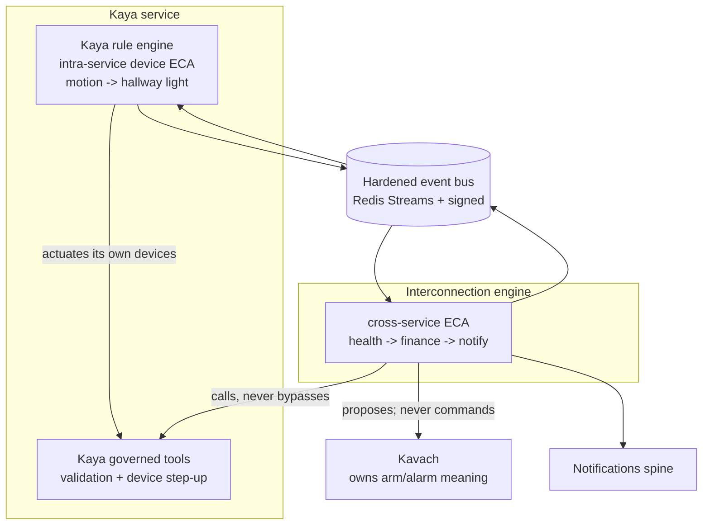

# ADR 0006 — Automation Principal & Event Bus

- **Status:** Accepted (Ananth, 2026-07-12) — green-lit for build; see CLAUDE.md rule 11
- **Date:** 2026-07-11
- **Deciders:** Ananth (owner), Claude (orchestrator)
- **Refines:** ADR 0001 §5.8, the Kernel design documentation §7;
  resolves design-review A5 / risk #26; contributes to D1.

> The "one mind" — proactive cross-domain automation — is Manas's headline value **and** its most dangerous
> surface: an event-condition-action engine sitting on the crown jewels (money, locks, health). This ADR pins
> down **who** an automation acts as (a named, least-privilege **rule-owner principal** — never a human
> super-user), **what** a rule is allowed to fire on unattended (never a **tainted**, untrusted-source fact),
> **what it may never do unattended** (move money, disarm/unlock), and **how** events reach it (a hardened,
> **signed** Redis Streams bus — no forgeable pub/sub). It also draws the missing line between **Kaya's** own
> device-ECA engine and the **platform Interconnection** engine.

---

## 1. Context

ADR 0001 §5.8 promotes a shared **Interconnection** spine: a cross-domain **event bus** plus a **cross-domain
ECA rules engine** that turns the one-mind flows *proactive* — a glucose trend nudges nutrition against the
grocery budget; an armed-away intrusion records a clip and notifies. The kernel already delivers the plumbing:
domain events raised by `WalledEntity` are enqueued to a **transactional outbox** in the *same* DB transaction
and dispatched **post-commit** to the bus (the Kernel design documentation §7).
ADR 0001 §6 upgrades the bus from the §5.8 sketch's "Redis pub/sub" to **durable Redis Streams + consumer
groups** (which also back GraphQL Subscriptions).

The **design review (A5 / risk #26)** found that, as written, the automation engine is a **confused-deputy
engine on the crown jewels**. Four defects, each critical:

1. **Impersonation.** The ECA principal is described as acting **"as Ananth."** That is a **human super-user**.
   It contradicts ADR 0001's non-negotiable — *"Sarathi is a deputy that carries the caller's verified
   identity, never a super-user; no component holds a super-key"* (§2.5, §5.2). A rule firing *as* a human
   punches through **every** wall that human can see, in one hop, with no human in the loop.
2. **Data-derived triggers are an injection path to actuation.** A crafted email, an OCR'd bill, or an LLM
   extraction becomes a "fact." If that fact can fire a **Tier-A** auto-action (e.g. a bill-pay), an attacker
   who can get text in front of the box can move money — prompt injection wired straight to the actuators.
3. **The bus is forgeable.** Plain Redis pub/sub is unauthenticated; **any local process** can publish a
   forged `intrusion.detected` or `balance.low` and drive the engine. Local-first is not local-trusted — the
   isolated-VLAN satellites and third-party integrations are *on the box's network*.
4. **Two engines, no boundary.** The design carries **Kaya's own rule engine** (intra-service device
   automations, from Vatara) **and** the **platform Interconnection engine** (cross-service). Their boundary
   and arbitration are unspecified — a recipe for two things fighting over one actuator, or a generic rule
   quietly redefining what "armed" means.

This ADR resolves all four. The governing principle is ADR 0001 §2.4: **the LLM is never a security
boundary; all actuation is deterministic and step-up-gated.** An automation is *more* privileged-looking than a
live human turn (it runs unattended), so it gets *less* ambient authority, not more.

---

## 2. The rule-owner principal (authored identity, least-privilege — not impersonation)

**An ECA rule runs under its own dedicated automation principal, scoped at author time — never as the human
who wrote it.**

- **Authored identity.** Every rule records, immutably at **author time**, the **`AuthorUserId`** (the human
  who created it) and the `TenantId` it belongs to. Authorship is for attribution, review, and revocation — it
  is **not** the identity the rule *runs as*.
- **A first-class principal.** Each rule executes under a **rule-owner principal** — a `ServiceId`-class
  identity minted in Pramana/Dwarpal of the form `rule:{ruleId}` (or a shared `automation` service identity
  carrying the `ruleId` as a claim). It is a real principal in Kutumba, holds its **own** delegation
  token, and is verified by every callee exactly like any other service identity
  (the internal trust design documentation, ADR 0003).
- **Its own wall scope, its own grants.** The rule-owner principal has **its own** wall scope and a set of
  **narrow, explicit, audited grants** — *only* the specific tools and data that *this* rule needs. A rule that
  must read Ananth's budget gets a grant for **"read Artha budget summary for `{scope}`"** — not "act as
  Ananth," not "read all of Artha." Grants are **least-privilege & enumerated** (a rule with no grant for a
  tool/read simply cannot call it — the wall
  (the Kernel design documentation §3, ADR 0004) rejects it deterministically at the
  data layer, not by policy hope) and **consented at author time** (a cross-domain rule that reads another
  member's data requires that member's or an admin's approval, captured as the grant — so "can Ananth's rule
  read the other adult's health?" is answered **once, explicitly, on record**, not silently at fire time).

- **`ActorContext` for a firing.** A firing sets:
  - `ServiceId` → the rule-owner principal (`rule:{ruleId}`) — the **actor**, for wall + attribution.
  - *(amended 2026-07-11, round 2 — closes S3)* **Data access is governed only by the rule-owner principal's
    machine-grants — never by the subject.** The human the action concerns (e.g. a nudge delivered to the
    child) travels as the delegation token's **`subject` claim** ([ADR 0003](0003-identity-propagation-and-pki.md) §2.2),
    resolved from the rule's declared scope — **not** from the author, and never a super-user. The `subject` is
    **delivery-targeting and audit metadata only**: it says who the action is *on behalf of* and where a
    notification lands. It is **never** consulted by wall evaluation. A firing that reads walled data is checked
    against the rule-owner principal's own **machine-grants** ([ADR 0004](0004-walling-maysee-and-sharing.md) §3
    row 10, §5 — cross-ref), exactly as §2 above already requires; the `subject` claim cannot substitute for a
    missing grant, and it does **not** trigger row-1 self-access off the subject's identity (that laundering hole
    is closed in ADR 0004 §5). Actions with no human subject (a house-wide device automation) carry the service
    actor only, with no `subject` claim.
  - `Roles` → the **grants of the rule-owner principal**, never the author's role set. A rule authored by an
    Admin does **not** inherit Admin.

This makes a rule strictly *weaker* than its author: it can do the enumerated few things, on the enumerated
scope, and nothing else — the confused-deputy hole is closed structurally.

---

## 3. Taint-tracking (untrusted-source facts cannot actuate unattended)

The trigger for defect #2 is that **facts are not all equally trustworthy**, yet the engine treats them
uniformly. We track **taint** on every fact and gate actuation on it.

- **Every event/fact carries a `Provenance` and a derived `Taint`.** Provenance names the origin; taint is a
  two-value lattice, **`Trusted`** or **`Tainted`**, computed from provenance:
  - **`Trusted`** — the fact came from a **deterministic, first-party source**: a physical sensor reading, a
    Plaid-settled transaction, a recorded vital from a paired device, a Kavach arm-state change, an in-app
    action a member took under their own verified identity.
  - **`Tainted`** — the fact was **derived from untrusted or model-mediated content**: an email/message body,
    OCR of a bill/receipt, an **LLM extraction/summarisation**, a web fetch, or *anything computed from a
    tainted input* (taint is **sticky/transitive** — a rule or projection that consumes a tainted fact yields
    tainted output; the highest taint of any input wins).
- **Propagation.** Taint is a first-class field on the domain event, persisted through the outbox, carried on
  the bus envelope (§5), and **preserved across the ECA engine's condition evaluation** — deriving a new fact
  never launders taint.
- **The action gate.** At the point a rule is about to **actuate or send** (a device command, a notification, an
  Artha tool, a Kavach call), the engine checks the **effective taint of every fact the condition depended
  on**:
  - **Trusted only** → the rule may fire **unattended** (subject to §4 and its grants).
  - **Any tainted input** → the rule **may not actuate/send unattended**. It converts to a **proposal**: the
    action is queued and a **step-up confirmation** is raised to the responsible human (ADR 0007). On explicit
    human approval the action proceeds *under that human's live, verified turn* (their identity, their
    step-up) — so a human, not a crafted email, authorised it. **Read-only** enrichment from a tainted fact is
    permitted; **actuation/sending is not.**
- **Worked example.** "When a utility bill arrives, pay it" — the "bill" is OCR/email-derived (**Tainted**).
  The rule can *draft* the payment and surface it, but **cannot** execute the transfer unattended; Ananth
  confirms with step-up. By contrast, "when the Plaid balance drops below $X, notify me" fires on a **Trusted**
  transaction and runs unattended (notify is not money-movement).

---

## 4. Tier-A exclusions (what no rule may ever do unattended)

ADR 0001's automation tiers let low-risk rules act unattended (**Tier-A**), higher-risk rules require
confirmation. Independent of tier and independent of taint, two action classes are **carved out of unattended
execution entirely**:

- **Money movement** — any Artha transfer, payment, trade, or external send.
- **Disarm / unlock** — any Kavach disarm, any lock-open, any disarm-class operation.

These **always require a live human step-up** ([`0007-risk-tiers-and-step-up.md`](0007-risk-tiers-and-step-up.md)),
**even from a fully-Trusted trigger**. A rule may *prepare* and *propose* such an action (draft the transfer,
stage the disarm), but the irreversible/safety-critical commit is never fired by a rule alone. This mirrors the
Vatara guarantee that **high-risk actuation is deterministic and PIN-gated in every path** — automation is just
another path, and the backstop tool enforces it regardless of how the rule was written.

---

## 5. Bus hardening (Streams + AUTH + TLS + signed events + idempotent consumers)

The bus is upgraded from the §5.8 pub/sub sketch to a **hardened, authenticated, integrity-checked** transport.
No fire-and-forget pub/sub carries anything that can trigger an action.

- **Durable Redis Streams + consumer groups** (per ADR 0001 §6) — at-least-once delivery, replay, per-consumer
  cursors; also backs GraphQL Subscriptions.
- **Transport auth + encryption.** Redis requires **AUTH** (per-service credentials from Pramana, no shared
  blank password) and **TLS** on every connection. No unauthenticated local client can connect.
- **Signed events (the integrity core).** Every event is **signed by its emitting service** using that
  service's **`ServiceId` key/cert** (the internal trust design documentation, ADR 0003).
  *(amended 2026-07-11, round 2 — closes S14)* The bus envelope carries `{ eventId, tenantId, ownerId,
  emitterServiceId, provenance, taint, correlationId, occurredAtUtc, payload, signature }`. **`ownerId`** is the
  owning member of the fact the event carries, **nullable for tenant-scoped events** (a house-wide device state
  change has no single owner). It exists because a consumer is never trusted to inherit the emitter's wall —
  every consumer **re-walls per [ADR 0004](0004-walling-maysee-and-sharing.md) §2.5**, resolving its own
  `ActorContext` (or rule-owner principal) and re-checking may-see before acting on or persisting anything
  derived from the event, and re-walling requires knowing the owner. **Consumers verify the signature against
  the emitter's registered cert and reject any event that is unsigned, has an invalid signature, or whose
  `emitterServiceId` is not authorised to emit that event type.** A forged `intrusion.detected` from a random
  local process has no valid signature and is dropped — closing defect #3. Signing happens at the **outbox
  dispatch** boundary so the signature covers exactly what was committed.
- **Idempotent consumers.** At-least-once ⇒ duplicates happen (redelivery, replay, retry). Every consumer is
  **idempotent**, keyed on `eventId` / the emitter's **idempotency key**, with a dedup window — cross-ref the
  idempotency + outbox convention ([ADR 0005](0005-audit-pipeline-and-tamper-evidence.md), ADR 0001 §14). A redelivered
  intrusion event fires the clip **once**, not twice.
- **Fail-closed.** A verification/AUTH/TLS failure **drops the event and raises a Saakshi alarm** (§7); it never
  degrades to accepting unsigned traffic.

---

## 6. Two-engine boundary & arbitration (Kaya vs Interconnection; Kavach sovereignty)

There are two ECA engines by design; this fixes their boundary (defect #4).

- **Kaya owns intra-service device ECA.** Device→device automations *within the home* — low blast radius,
  high frequency, e.g. "motion → hallway light," "sunset → porch on." These stay in **Kaya's own rule engine**
  (carried from Vatara), run under a **Kaya-scoped rule-owner principal**, and actuate via Kaya's own validated
  device path. The platform engine does **not** re-implement them.
- **Interconnection owns cross-service ECA.** Rules whose trigger and action span services — health→finance→
  notify, finance→schedule, security→notify. These run in the **platform engine** under a per-rule rule-owner
  principal (§2).
- **Arbitration rule — cross-service rules never actuate devices directly.** A cross-service rule that needs a
  device changed **calls Kaya's governed tool**, which applies **Kaya's own** validation, entity mapping, and
  device step-up. The platform engine holds no device driver and no device authority; Kaya remains the single
  writer to devices, so Kaya's rules and the platform's proposals converge through **one** validated actuator
  (no split-brain, no double-fire). Where both could act on the same device, **Kaya's tool is the arbiter** —
  it serialises and validates; the platform rule is just another caller.
- **Kavach sovereignty (hard rule).** **A security-domain action — arm, disarm, alarm, entry-delay — is NEVER
  driven by a Kaya rule or a generic platform rule.** Only **Kavach** owns the *meaning* of arming and
  alarming. Other engines may **emit an event** Kavach subscribes to, or **propose** via a Kavach governed tool
  (which applies Kavach's own policy + the §4 disarm-class step-up) — but they can never redefine or directly
  drive security state. A "motion → light" rule cannot become a "motion → disarm" rule by misconfiguration; the
  disarm verb simply isn't in any non-Kavach principal's grants.

---

## 7. Auditing rule firings

Every firing — **fired, proposed, or rejected** — is recorded to **Saakshi**
([`0005-audit-pipeline-and-tamper-evidence.md`](0005-audit-pipeline-and-tamper-evidence.md)) as a first-class, hash-chained event:

`{ ruleId, authorUserId, ruleOwnerPrincipal, triggerEventId, triggerTaint, conditionResult, actionRequested,
gateDecision (fired | proposed-step-up | rejected-tier-A | rejected-taint | rejected-grant), stepUpActor?,
outcome, correlationId, occurredAtUtc }`.

- The `correlationId` threads the trigger event → condition eval → action → step-up → outcome into **one**
  reviewable chain.
- **Denials are audited, not just successes** — a grant-less read attempt, a rejected unsigned event, a
  taint-blocked actuation each leave a record, so the confused-deputy surface is *observable*.
- Rule authorship changes and grant changes are themselves audited (who gave `rule:{ruleId}` the "read
  the other adult's health summary" grant, and when).

---

## 8. Acceptance criteria / tests

Concrete, buildable assertions the Interconnection spine must satisfy (each maps to a test):

1. **Tainted fact cannot fire a payment rule (the headline).** Feed an **email/OCR-derived** "bill" fact
   (`Taint = Tainted`) to a "pay the bill" rule ⇒ the action gate returns **proposed-step-up**, **no transfer
   executes**, and a step-up request is raised. A **Plaid-settled** equivalent (`Trusted`) into a *notify* rule
   fires unattended.
2. **Tier-A exclusion holds from a Trusted trigger.** A **fully-Trusted** trigger wired to a disarm/unlock or a
   money-movement action ⇒ still **requires live human step-up**; the rule alone never commits it.
3. **Unsigned / bad-signature event is rejected.** Publish an event with no signature, a tampered payload, or a
   signature from a non-authorised `emitterServiceId` ⇒ the consumer **drops it** and raises a Saakshi alarm;
   the rule does **not** fire.
4. **A rule cannot read data its rule-owner lacks a grant for.** A rule whose principal has no "read Artha
   budget" grant attempts that read ⇒ the wall **rejects** it at the data layer (typed denial), the read
   returns nothing, and the denial is audited — the author's own Admin role does **not** rescue it.
5. **No impersonation in `ActorContext`.** *(amended 2026-07-11, round 2 — closes S3)* Inspect the
   `ActorContext` of any tool call a rule makes ⇒ `ServiceId = rule:{ruleId}`, `Roles =` the rule-owner's
   grants, and the token's **`subject` claim** names the declared subject or is absent — **never** the author
   as a super-user. Separately, assert **wall evaluation sees only the principal's machine-grants**: a firing
   whose `subject` names a member the rule-owner has **no** machine-grant for still returns **no data** for
   that member — the `subject` claim alone never widens what the rule can read.
6. **Taint is sticky/transitive.** A rule condition that derives a new fact from one Trusted and one Tainted
   input yields a **Tainted** result at the action gate (highest-taint-wins), and actuation is blocked.
7. **Idempotent consumer.** Redeliver the same intrusion `eventId` three times ⇒ the clip/notify action
   executes **once**.
8. **Cross-service rule cannot drive a device directly.** A platform rule attempts a direct device write ⇒ no
   device API is reachable to it; the only path that succeeds is **calling Kaya's governed tool**, which
   re-validates.
9. **Kavach sovereignty.** A Kaya/generic rule configured to "disarm on X" ⇒ **fails at authoring/registration**
   (the disarm verb is not in a non-Kavach principal's grant set); only a Kavach-owned rule/tool can.
10. **Firing audit completeness.** Every fired/proposed/rejected outcome above produces a hash-chained Saakshi
    row with the `correlationId` linking trigger → decision → outcome.

---

## 9. Open questions

1. **Rule-owner principal granularity** — one distinct `rule:{ruleId}` identity per rule (cleanest blast-radius,
   more principals to mint/rotate) vs. a shared `automation` service identity carrying `ruleId` + a per-rule
   grant set (fewer identities, grant set is the real boundary). Leaning per-rule for auditability; confirm the
   Pramana minting/rotation cost on the home server.
2. **Taint beyond binary.** Is a two-value `Trusted`/`Tainted` lattice enough, or do we need a **provenance
   confidence score** (e.g. a signed-PDF bill vs a free-text email) that some low-risk actuations can threshold
   on? Start binary; reserve the field.
3. **Author-time consent UX** — how a cross-member grant is requested and approved (in-app card, notification,
   admin override) without making cross-domain rules so heavy nobody authors them. Owned jointly with the
   onboarding/setup flow.
4. **Tainted-proposal expiry & batching** — how long a queued step-up proposal lives, and whether repeated
   tainted triggers (a bill that re-arrives daily) collapse into one pending proposal rather than spamming.
5. **Signing key rotation on the bus** — how in-flight/replayed events verify across an emitter cert rotation
   (key-version on the envelope, overlap window); jointly owned with Pramana / ADR 0003.

---

## 10. Consequences

- **The confused-deputy hole is closed structurally.** An automation is now strictly *weaker* than its author —
  a named principal with enumerated grants, not a human super-key. "No component holds a super-key" (ADR 0001)
  finally holds for the automation engine, the one place it was most violated.
- **The injection→actuation path is cut.** A crafted email or OCR'd bill can *inform* and *propose*, but cannot
  *act* unattended; the human step-up on tainted actuation is the firebreak between prompt injection and the
  actuators.
- **The bus is trustworthy.** Signed events + AUTH + TLS mean a fact on the bus provably came from the service
  entitled to emit it — local-first stops meaning local-trusted, which the isolated-VLAN satellites and
  third-party integrations require.
- **The two engines have a clean seam.** Kaya keeps its fast, low-blast-radius device automations; the platform
  owns cross-service reasoning and reaches devices *only* through Kaya's validated tool; Kavach's security
  meaning is sovereign. No split-brain over an actuator, no rule redefining "armed."
- **More machinery, deliberately.** Per-rule principals + grants, a taint field threaded through outbox→bus→
  engine, event signing/verification, and an action-gate step in the ECA loop. This is real cost — but it is
  the cost of putting an unattended automation engine on money, locks, and health, and it is testable (§8) and
  mostly invisible to a rule *author*, who just picks a trigger, a condition, and an action.
- **Constrains its siblings.** It leans on **ADR 0003** (service identity + delegation tokens + cert signing),
  **ADR 0004** (walls that reject the grant-less read), **ADR 0007** (the step-up that tainted + Tier-A actions
  fall back to), and **ADR 0005** (the hash-chained firing audit + idempotency). Those ADRs must deliver those
  primitives; this ADR consumes them and adds nothing that bypasses them.

---

*Refines [`0001-manas-platform-architecture.md`](0001-manas-platform-architecture.md) §5.8 and
the Kernel design documentation §7. Resolves design-review A5 / risk #26;
contributes to D1. Cross-references [`0003-identity-propagation-and-pki.md`](0003-identity-propagation-and-pki.md)
(identity), [`0004-walling-maysee-and-sharing.md`](0004-walling-maysee-and-sharing.md) (walls),
[`0005-audit-pipeline-and-tamper-evidence.md`](0005-audit-pipeline-and-tamper-evidence.md) (audit + idempotency),
[`0007-risk-tiers-and-step-up.md`](0007-risk-tiers-and-step-up.md) (step-up), and the internal trust/credential
layer that mints and signs the rule-owner and service identities.*
