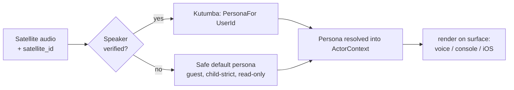

# Manas — Vesha: the Persona Layer (the assistant's embodiment)

- **Status:** Design
- **Date:** 2026-07-11
- with [ADR 0001](../adr/0001-manas-platform-architecture.md) §5.6 + [ADR 0007](../adr/0007-risk-tiers-and-step-up.md) (voice-is-a-hint)

> One brain, many faces. Sarathi is a single reasoning core (`qwen3:30b-a3b` via **Medha**) that **wears a
> different persona per household member** — Ananth hears **Anik** (dry, adult); the child hears **Bonnie** (loving,
> loyal, patient, funny, child-safe — the product's **north star**). A persona shapes **delivery only**: the
> voice, the wording, the mascot's smile. It **never** changes what is true, what is safe, or what a member may
> access. This doc specifies the persona spine — its config schema, how it resolves, how it renders identically
> on every surface, and the hard guardrail that keeps it a *rendering pass* and never a decision.

The spine's name is **decided: Vesha** (वेष, "guise/costume") — 2026-07-12, ADR 0001 §5.6. (Candidates were
Swabhava "temperament", Vyaktitva "personality", Vesha.) Referred to as **Vesha** below.

---

## 1. The persona model

A persona is **data, not code** — a validated config record loaded at startup, hot-reloadable, resolved from the
household **Kutumba**. One record fully describes one embodiment:

```yaml
# config/personas/bonnie.yaml   (one file per persona; hot-reloaded, schema-validated at startup)
id: bonnie                       # stable persona key (referenced by member binding)
displayName: Bonnie              # the name the assistant answers to / signs replies as
memberBinding: child1             # Kutumba UserId this persona is the default embodiment for

voice:                           # → Piper TTS render target
  engine: piper
  voiceId: en_US-lessac-high     # A/B-picked on the box; NOT a pitched adult voice
  rate: 1.0
  pitch: 0                       # PITCH-SHIFT FOR A CHILD VOICE IS BANNED (rejected as "creepy" — see ADR 0001)

toneFragment:                    # a VERSIONED, TESTABLE prompt fragment — never free-form per call
  ref: tone/bonnie              # points at config/personas/tone/bonnie.v3.txt
  version: 3                     # bumped on edit; eval corpus pins to a version
  # "Warm, patient, playful older-sister energy. Short sentences. Celebrate effort.
  #  Curious, never condescending. Explain, don't do homework for her."

refusalTemplates:                # (amended 2026-07-11, round 2 — closes G12/R4) versioned refusal wording —
  ref: refusals/bonnie          # points at config/personas/refusals/bonnie.v1.yaml
  version: 1                     # bumped on edit; eval corpus pins to a version — the LLM never words a refusal

safetyRegister: child-strict     # adult | child-strict — see §5 (child persona ⇒ child-strict is FORCED)
greetingStyle: playful           # keyed into Greeting (time-of-day + name): "Morning, kiddo! What are we up to?"
wakeWord:
  primary: "Hey Bonnie Blue"     # custom — UNPROVEN (ADR 0001 §5.7 risk)
  fallback: built-in             # openWakeWord pretrained OR tap-to-talk (keeps the box shippable)
mascotSet: bonnie-face-v1        # → config/animations.v1.json set id (320×240 face; [anim:x] cues + keyword fallback)
```

### Field reference

| Field | Type | Purpose / rule |
|---|---|---|
| `id` | string | Stable persona key; referenced by member bindings and satellite defaults. |
| `displayName` | string | The name spoken/shown; the assistant signs as this. |
| `memberBinding` | UserId? | Kutumba member this persona is the default for (null = shared/guest persona). |
| `voice.engine/voiceId` | enum/string | Piper voice. **Pitch-shift for a child voice is prohibited** — pick a natural voice. |
| `voice.rate/pitch` | float | Delivery tuning only; `pitch` stays `0` for child personas (enforced by validation). |
| `toneFragment.ref/version` | ref+int | **Versioned prompt fragment** injected at generation time — not authored per turn, so it is diffable, reviewable, and pinnable by the eval corpus. |
| `refusalTemplates.ref/version` | ref+int | *(amended 2026-07-11, round 2 — closes G12/R4)* **Versioned refusal wording** for blocked/denied Results — schema-validated, eval-pinned like `toneFragment`; renders from config, never worded by the LLM (§4/§5). |
| `safetyRegister` | enum | `adult` \| `child-strict`. A child persona **cannot** be configured `adult` (startup validation rejects it). |
| `greetingStyle` | enum | Selects the greeting template family (time-of-day + name aware). |
| `wakeWord.primary/fallback` | string/enum | Per-persona wake word + a guaranteed fallback (built-in or tap-to-talk). |
| `mascotSet` | id | Animation set for the satellite face + web avatar motif. |

**Validation at startup** (fail-closed, never ship a half-persona): every `memberBinding` resolves in
Kutumba; `voiceId` exists in the Piper voice catalog; `toneFragment.ref@version` file exists; *(amended
2026-07-11, round 2 — closes G12/R4)* `refusalTemplates.ref@version` file exists and is schema-valid; a
`child-strict` persona has `pitch == 0`; `mascotSet` exists in `animations.v1.json`. A malformed persona is refused
and the member falls back to the safe default persona (§2) with a health alert (Bodha).

---

## 2. Resolution — who is Sarathi talking to?

**Speaker identity is the authority; the room is only a hint** (cross-ref [ADR 0007](../adr/0007-risk-tiers-and-step-up.md),
voice-is-a-hint). Sarathi resolves the persona while building `ActorContext`, *before* any LLM call:

```
speaker audio / session
   │  Wyoming satellite_id → room default persona (a HINT)        e.g. the child's-room box ⇒ bonnie
   │  speaker identification (voiceprint / signed session)        VERIFIED identity
   ▼
ActorContext.UserId ──► Kutumba.PersonaFor(UserId) ──► persona binding   (identity WINS over room)
   │
   ├─ verified speaker ≠ room's default  →  use the SPEAKER's persona   (Ananth on the child's box ⇒ Anik)
   └─ unknown speaker                    →  SAFE DEFAULT persona + guest handling (§ below)
```



- **Room default:** a satellite/room may declare a default persona (the child's-room box → Bonnie) so an
  unenrolled-but-expected speaker gets the right face. This is a *hint*, overridden by any verified identity.
- **Verified override:** if the speaker is verified as a different member, their persona wins — Ananth speaking
  into the box hears Anik, not Bonnie. Access follows *identity*, never the room's default.
- **Unknown speaker → safe default:** an unidentified voice gets a neutral guest persona with **child-strict
  register** (safest assumption when age is unknown), read-only access, and no personalized memory. Persona
  resolution never fabricates an identity to grant access.

---

## 3. Uniform application across surfaces

**One persona definition, many render targets.** Each surface maps the same persona attributes onto its own
capabilities — no surface re-invents the persona:

| Persona attribute | Voice satellite (BOX-3) | Web console (Akriti) | iOS app |
|---|---|---|---|
| `displayName` | spoken name, signs replies | header + chat sender name | nav title + chat sender |
| `voice` | Piper TTS on the box speaker | optional in-browser TTS playback | on-device / streamed TTS |
| `toneFragment` | shapes the spoken reply | shapes the chat reply | shapes the chat reply |
| `greetingStyle` | wake-time spoken greeting | dashboard greeting card | app-open greeting |
| `wakeWord` | on-device wake / tap-to-talk | n/a (typed / push-to-talk mic) | tap-to-talk |
| `mascotSet` | 320×240 animated face, cue-driven | avatar / arc-reactor motif, same cue vocabulary | avatar, same cues |
| `safetyRegister` | gates STT→Sarathi→Governor | gates the same pipeline | gates the same pipeline |

The **mascot cue vocabulary is shared**: Sarathi emits an `[anim:x]` tag (keyword fallback if absent); each
surface maps the cue to its renderer — the box draws the face frame, the console/iOS animate the avatar. A new
surface implements the attribute→capability map once and inherits every persona for free.

---

## 4. The delivery-only guardrail (critical) *(amended 2026-07-11, round 2 — closes G12/R4)*

**Persona is a rendering pass over an already-decided `Result`. It is NEVER in the decision path.**

The deterministic work — safety gates, MCP tool validation, the Kernel wall check, the factual/numeric content
of the answer — completes **first** and produces an immutable `Result`. **Decisions (refusals, wall denials,
step-up requirements) are always formed as typed Results before any token streams** — what streams is only the
wording of an already-decided outcome. The **Governor** then applies the persona *to that Result*, streamed:

```
[input] → Safety Gate → Sarathi(LLM) → tool validate → Kernel(wall+audit) → Result (decided, immutable)
                                                                              │
                                                              ┌───────────────┘
                                                              ▼
                                                   Governor: scan-before-release gate
                                                     • scan EVERY sentence (output-safety + persona rules),
                                                       then release them all — nothing releases early
                                                     • pick voice (Piper), choose mascot cue
                                                     ✗ CANNOT flip a refusal
                                                     ✗ CANNOT change a number/fact
                                                     ✗ CANNOT widen a wall decision
                                                     ⚡ stream-kill: a failing sentence ANYWHERE kills the WHOLE
                                                       answer — nothing is released; the reply is the safe
                                                       (template) rendering + its deterministic redirect
                                                              ▼
                                                   TTS chunk / console delta, sentence by sentence
```

*(amended 2026-07-11, round 2 — closes G12/R4; release rule further amended 2026-07-29 — see the
scan-before-release note below)* **The streaming model.** The tone fragment is injected at
**generation time**, not by a post-hoc rephrase — persona already resolves *before* the LLM call (§2), so this
is legal and needs no second pass. The **Governor becomes a deterministic, sentence-buffered release gate**:
**every** generated sentence passes the output-safety scan + persona rules, and **only then** do the sentences
release to the egress adapter (console delta / TTS chunk — composing with wyoming-piper's sentence streaming;
[ADR 0010](../adr/0010-agent-conversational-core.md) §6, §6.1). The Governor keeps **stream-kill authority**: a
failing sentence **anywhere in the answer** kills the whole answer — **no sentence is released at all** — and
the reply is replaced with the safe (template) rendering, carrying the deterministic comfort/redirect append
where the turn has one. **The invariants STAND:**
decisions are formed as typed `Result`s before any token streams, and the Governor still **cannot** flip a
refusal, soften a block, or widen a wall decision — streaming changes *when* wording is released, never *what*
was decided.

> **Amendment 2026-07-29 — scan-before-release (owner-authorised; normative text in [ADR
> 0010](../adr/0010-agent-conversational-core.md) §6.1).** *Superseded wording, recorded not deleted:* this
> paragraph and the stage diagram above previously read *"each generated sentence passes the output-safety scan
> + persona rules, then releases"* and *"a failing sentence stops the stream, and the persisted turn is
> atomically rewritten to the safe rendering in the same transaction — a client replaying from the store can
> never see a killed sentence."* Under that rule a kill stopped the stream **at** the offending sentence, so the
> sentences before it had already been delivered. **Reason for the change:** harm does not respect sentence
> boundaries — an innocuous opener ("Get the bottle from under the kitchen sink.") followed by the payload
> ("Then drink the whole thing.") delivered the *instructional half* to the child and withheld only the payload,
> and delivery to a child cannot be retracted. **Cost: none** — `IGovernor.Render` returns the complete
> rendering synchronously and stage 10 emits from it afterwards, so no sentence had left the process before the
> scan loop finished even under the old rule; the §6 latency targets are unchanged. The atomicity guarantee is
> *subsumed, not weakened*: with nothing released before the scan completes there is no killed wording in any
> persistable artefact and no socket leak surface at all.
>
> **A killed VOICE turn speaks (unit VOICE-KILL-SPEAK, 2026-07-29).** Because a kill releases no sentences, the
> voice egress adapters — which synthesize released sentences — emitted nothing, so `GET /voice/tts/{turnId}`
> answered `204` and a killed voice turn was **dead air**. Silence from a trusted companion is its own harm to a
> small child. A killed rendering now emits **exactly one** TTS request carrying the persona's versioned
> `streamKilled` template plus the deterministic comfort/redirect append where the turn carries one — so the
> spoken surface is never poorer than the screen, and still carries **zero** model wording.

**Blocked/denied Results are never worded by the LLM.** They render from **versioned, per-persona refusal
templates** (`config/personas/refusals/{persona}.vN.yaml`, schema-validated, eval-pinned exactly like tone
fragments — §1) — the model never re-sees the blocked input and never composes its own refusal wording.
Bonnie's and Anik's refusal templates differ in tone only; the decision they render is identical (§7).

The Governor's input is a typed, already-decided `Result` (allow/refuse/answer + payload); it has **no handle**
on the Safety Gate, the wall, or the tool layer, so it *structurally cannot* re-open a decision — it can only
scan and release wording. What persona **may** do: shape generation-time tone, choose the voice, pick the
mascot cue, adjust warmth/verbosity. What persona **may not** do: turn a refusal into an approval, soften a
safety-gate block into compliance, widen a wall (data-access) decision, or alter a factual value or number (the
**anti-sycophancy** rule — *personalize delivery, never truth*).

**A child-safe refusal is still a refusal — just phrased kindly.** If the deterministic gate blocks the child's
request, the *decision* is REFUSE; Bonnie's refusal template renders it warmly:

> Decision: `REFUSE (child-strict, topic out-of-bounds)` → Bonnie's refusal template renders: *"That's
> grown-up stuff — ask your dad! Wanna hear a joke instead?"*

Same block, Anik's refusal template would render dry and terse. **The block does not move.**

---

## 5. Persona × safety composition *(amended 2026-07-11, round 2 — closes G12/R4)*

Persona **composes with** the deterministic safety stack; it never **replaces** it.

- **Child persona ⇒ child-strict is FORCED.** A persona bound to a Child member (Bonnie/the child) is validated
  `safetyRegister: child-strict` at startup — it *cannot* be configured `adult`. Register is a property of the
  member's role first; persona may only match it, never relax it.
- **The classifiers run regardless of persona.** The input Safety Gate in `CommandPipeline` — lexical floor +
  Llama-Guard, plus **ShieldGemma child-strict on a Child's turns** — runs on the *ActorContext role*, not the
  persona's tone. Even if a persona's tone fragment were mis-authored "permissive," the deterministic child
  classifiers still fire on the child's turns.
- **Tone never downgrades a tier.** The Governor's per-edge output safety is deterministic; persona chooses
  *wording* within the tier the decision already set. Warmth is not an override — Bonnie sounds gentle *and* the
  ShieldGemma block still holds.
- *(amended 2026-07-11, round 2 — closes G12/R4)* **Refusals render from templates, never from the model.** A
  blocked/denied Result always renders from the persona's versioned `refusalTemplates` (§1), never from an LLM
  wording pass over the blocked input — this holds regardless of streaming, so a mid-stream kill and a stage-4/5
  block both resolve to the same template-rendered safe wording.

| Layer | Determined by | Persona's influence |
|---|---|---|
| Input safety gate (lexical + Llama-Guard + ShieldGemma) | ActorContext **role** | none — runs regardless |
| Tool validation + wall (Kernel) | deterministic policy | none — decided before Governor |
| Output governor (per-edge safety tier) | the `Result`'s decision | none on the tier; wording only |
| Delivery (voice/tone/mascot/greeting) | **persona** | full — this is persona's whole job |

---

## 6. Extensibility (Open/Closed, capability-module style)

**Adding a persona = new config + optional voice/mascot assets. Zero code.**

1. Drop `config/personas/<id>.yaml` (schema above) + `config/personas/tone/<id>.vN.txt`.
2. (Optional) add a Piper voice to the catalog and a mascot set to `animations.v1.json`.
3. Bind it to a member (or a room default) in Kutumba.

Startup validation loads and checks it; Sarathi resolves it and the Governor renders it with **no code
change** — the same way a new capability module plugs into the kernel. Because personas are pure data behind the
`Kutumba.PersonaFor` seam, the reasoning core, safety stack, and surfaces are all closed for modification but
open for new embodiments.

---

## 7. Testing *(amended 2026-07-11, round 2 — closes G12/R4)*

Two tiers — deterministic resolution/config checks, and behavioral eval — with **"Bonnie is the north star"**
as the top priority.

**Deterministic checks** (fast, no LLM):
- `PersonaFor(child1)` resolves `bonnie`; `PersonaFor(ananth)` resolves `anik`.
- Bonnie resolves voice `en_US-lessac-high`, wake `"Hey Bonnie Blue"` (+ fallback present), register
  `child-strict`, `pitch == 0`.
- A verified different speaker on the child's-room box overrides the room default (Ananth ⇒ Anik).
- Unknown speaker ⇒ safe default persona, child-strict, read-only, no personalized memory.
- Config validation **rejects**: a Child persona set `adult`; a child persona with non-zero pitch; a missing
  `voiceId` / `toneFragment@version` / `refusalTemplates@version` / `mascotSet`.
- *(amended 2026-07-11, round 2 — closes G12/R4)* **Stream-kill**: inject a mid-stream output-safety-scan
  failure and assert the client never receives the killed sentence, the persisted `Turn` matches the safe
  (refusal-template) rendering byte-for-byte, and the kill is audited under the turn's `cid` (ADR 0010 §6).

**Eval checks** (the eval harness — N-run + judge + deterministic graders; `Category=Eval`):
- **Bonnie** stays loving/patient/child-safe; explains but **does not do the child's homework**; never uses an
  adult/dry register.
- **Anik** stays dry/adult; doesn't slip into child-cutesy tone.
- **Persona-invariance-under-safety** (the load-bearing suite): for the *same* refusal or blocked input, **every
  persona still refuses** — Bonnie kindly, Anik tersely, but **neither ever softens the refusal, changes a
  number, or leaks another member's data**. Persona changes wording; the decision is invariant. *(amended
  2026-07-11, round 2 — closes G12/R4)* The suite **pins `refusalTemplates.version` per persona** alongside
  `toneFragment.version`, so a refusal-wording edit is re-verified before rollout exactly like a tone edit.
- Cross-persona data-isolation: no persona surfaces another member's private data (wall holds under any tone).

Tone fragments **and refusal templates are version-pinned** so the eval corpus tests a known persona revision;
bumping `toneFragment.version` or `refusalTemplates.version` requires re-running the persona eval before
rollout.

---

## 8. Open questions

- **Spine name** — finalize among Swabhava / Vyaktitva / Vesha (or keep `Persona`).
- **Per-persona LLM sampling** — should temperature / top-p be persona attributes (Bonnie warmer/looser, Anik
  tighter), and if so how do we keep sampling changes from drifting *truth* (they must not)?
- **Avatar/mascot asset pipeline** — how are mascot sets authored, versioned, and OTA-shipped to the box vs. the
  console/iOS avatar (shared cue vocabulary, different renderers)?
- **Multi-persona in a shared space** — when two members are present at one satellite, *which persona speaks*?
  (Nearest/loudest verified speaker? The addressed member? Interaction with barge-in from ADR 0001 §5.7.)
- **Guest persona depth** — how much personality does the safe-default guest persona get before it risks feeling
  like a real member?
